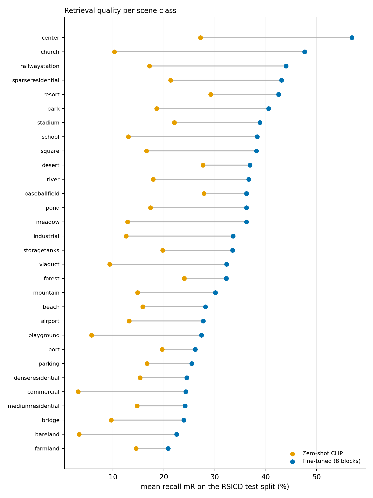

# Vision-Language Retrieval for Remote Sensing

Contrastive image-text alignment of remote-sensing images and captions in a shared embedding space (CLIP-style
dual encoder), evaluated for image-to-text and text-to-image retrieval, per scene class, and on datasets the model
never saw during training.

## Layout
```
data/        dataset index builder (+ generated indexes, ignored by git)
retrieval/   index loading, encoding, retrieval metrics
train/       contrastive fine-tuning (train_clip.py)
eval/        zero_shot.py (any split), per_scene.py, transfer.py (cross-dataset)
analysis/    check/figure/table scripts (per_scene_report.py, make_tables.py)
tools/       inspect_dataset.py, check_overlap.py (near-duplicate / leakage check)
tests/       python tests/test_basics.py   (metric sanity checks)
```

## Setup 
```
pip install -r requirements.txt
```

## Data
RSICD (https://github.com/201528014227051/RSICD_optimal), RSITMD (https://github.com/xiaoyuan1996/AMFMN)
and UCM-Captions, unzip next to their `dataset_*.json`, then build one index per dataset (official splits are used):
```
python data/prepare_rsicd.py --root datasets --out data/rsicd/index.jsonl
python data/prepare_rsicd.py --root datasets/RSITMD_images --annotations datasets/dataset_rsitmd.json --name rsitmd --out data/rsitmd/index.jsonl
python data/prepare_rsicd.py --root datasets/UCM_images --annotations datasets/dataset_ucm.json --name ucm --out data/ucm/index.jsonl
```
Leakage check (see Results: RSITMD overlaps heavily with RSICD):
```
python tools/check_overlap.py --source data/rsicd/index.jsonl --target data/rsitmd/index.jsonl --out analysis/overlap_rsitmd
python tools/check_overlap.py --source data/rsicd/index.jsonl --target data/ucm/index.jsonl --out analysis/overlap_ucm
```

## Run
```
# zero-shot baseline
python eval/zero_shot.py --index data/rsicd/index.jsonl --split test --out results/zeroshot_rsicd_test
# memory/speed check, then training (repeat with --seed 1, --seed 2 and --name ft_last4_s1 ...)
python train/train_clip.py --index data/rsicd/index.jsonl --smoke
python train/train_clip.py --index data/rsicd/index.jsonl --name ft_heads --unfreeze-last 0
python train/train_clip.py --index data/rsicd/index.jsonl --name ft_last4 --unfreeze-last 4
python train/train_clip.py --index data/rsicd/index.jsonl --name ft_last8 --unfreeze-last 8
# per-scene and cross-dataset evaluation
python eval/per_scene.py --index data/rsicd/index.jsonl --split test --models zeroshot ft_last4=checkpoints/ft_last4.pt ft_last8=checkpoints/ft_last8.pt
python eval/transfer.py --index data/ucm/index.jsonl --split test --models zeroshot ft_last8=checkpoints/ft_last8.pt
python eval/transfer.py --index data/rsitmd/index.jsonl --split test --overlap-csv analysis/overlap_rsitmd.csv --models zeroshot ft_last8=checkpoints/ft_last8.pt
python analysis/per_scene_report.py --results results --out-dir analysis/report
python analysis/make_tables.py --results results --out analysis/report/results_tables.md
```

---

# Results

All numbers come from the JSON files in `results/` (tables generated by `analysis/make_tables.py`).

**Method.** OpenCLIP ViT-B/32 initialised from the OpenAI weights, fine-tuned on RSICD (8,734 training images, 5 captions
each) with the symmetric InfoNCE loss and a learned temperature. Each step uses a batch of 64 distinct images with one
randomly chosen caption each (no caption of another image in the batch is a hidden positive). AdamW (lr 1e-5, weight decay
0.1), 5% linear warm-up then cosine decay, fp16 mixed precision, gradient clipping 1.0, random flips and 90-degree
rotations, at most 15 epochs with early stopping (patience 4) on validation mean recall. The test split is evaluated once,
with the epoch chosen on validation. Three variants: only the projection layers and temperature (0.7M parameters), plus
the last 4 transformer blocks of both towers (41.6M), plus the last 8 blocks (82.6M). Three seeds (0, 1, 2) for the
4- and 8-block models. Hardware: RTX 3050 laptop GPU with 4 GB (peak memory 1.4, 2.1 and 3.5 GiB for the three variants;
about 9, 6-13 and 25 minutes per run), which is why the full model was not fine-tuned.

**Metric.** Recall@1/5/10 in both directions and their mean (mR, six numbers). Image-to-text: a query is correct if any of
the image's 5 captions is in the top K. Text-to-image: correct if the caption's image is in the top K. Ties are counted
against the model. Mean ± standard deviation over seeds (sample sd, n = 3).

**RSICD test (in-domain; 1,093 images, 5,465 captions).**

| Method | Runs | i2t R@1 | i2t R@10 | t2i R@1 | t2i R@10 | mR |
|---|---|---|---|---|---|---|
| Zero-shot CLIP | 1 | 4.9 | 23.0 | 5.5 | 27.8 | 15.5 |
| Projections only | 1 | 8.5 | 34.4 | 7.9 | 41.1 | 23.5 |
| Last 4 blocks | 3 | 13.0 ± 0.7 | 44.8 ± 1.7 | 12.1 ± 0.5 | 50.1 ± 0.9 | 30.7 ± 0.6 |
| Last 8 blocks | 3 | 16.0 ± 1.0 | 45.9 ± 1.9 | 13.0 ± 0.6 | 53.2 ± 1.1 | **33.0 ± 1.3** |

Fine-tuning roughly doubles mean recall and more than doubles R@1 in both directions. More trainable layers help, with
diminishing returns (about +8, +7.2 and +2.3 mR over the previous row); the 8-block gain over 4 blocks is modest relative to its
seed spread. For context, published fine-tuned results on RSICD with this backbone family are in the same range (an earlier
CLIP fine-tuning baseline 27.4 mR, RemoteCLIP ViT-B/32 35.3 mR); those were not re-run here and use different training data and
protocols, so no ranking is claimed. Zero-shot scores on RSICD differ by about 0.7 mR depending on whether the OpenAI weights
are loaded with the matching QuickGELU activation (the loader enforces it).

**Per scene class (RSICD test; zero-shot vs the seed-0 8-block model; [View per-scene performance table](analysis/report/per_scene_table.md))**


Fine-tuning improved all 30 classes (gain +6.3 to +37.4 mR). Largest gains: church (+37.4), center (+29.7), railway station
(+26.8), school (+25.3). Smallest: farmland (+6.3), port (+6.5), forest and baseball field (+8.3). After fine-tuning the best
classes are center (56.9), church (47.6) and railway station (44.0); the worst are farmland (20.8), bareland (22.5) and bridge
(23.9). A plausible but untested reading: classes with a distinctive landmark are easy, while uniform textures and neighbouring
residential/commercial classes are hard. Each class has only 24-46 test queries, so small differences between classes are noise.
66 of the 1,093 test images (and 921 of 10,921 in total) have numbered file names with no class label; they are excluded as
queries from the per-class numbers but remain in the gallery.

**Zero-shot transfer to UCM-Captions (never seen; test split, 210 images, 1,050 captions; no near-duplicates with RSICD).**

| Method | Runs | i2t R@1 | i2t R@10 | t2i R@1 | t2i R@10 | mR |
|---|---|---|---|---|---|---|
| Zero-shot CLIP | 1 | 6.2 | 46.7 | 8.7 | 60.3 | 30.2 |
| Projections only | 1 | 6.7 | 53.3 | 10.8 | 72.5 | 34.7 |
| Last 4 blocks | 3 | 8.9 ± 0.3 | 58.6 ± 2.9 | 12.8 ± 0.7 | 75.0 ± 0.8 | 37.7 ± 0.6 |
| Last 8 blocks | 3 | 8.4 ± 1.8 | 56.8 ± 3.3 | 13.5 ± 0.8 | 74.6 ± 2.4 | 37.5 ± 1.2 |

Training on RSICD improves retrieval on UCM by about 7 mR over zero-shot CLIP. Unlike on RSICD, 8 blocks are no better than 4
there, so the extra capacity does not buy extra transfer. The gallery is small (210 images), so recalls are not comparable
with the RSICD tables.

**RSITMD: most of its test set is also in RSICD.** A perceptual-hash comparison (`tools/check_overlap.py`, 256-bit dHash, 8
rotations/flips, checked visually) found that 441 of the 452 RSITMD test images (97.6%) have a near-duplicate in RSICD, 361 of
them (80%) in RSICD's training or validation split. A plain "train on RSICD, test on RSITMD" number would therefore mostly
measure images the model had trained on, and is not reported as generalization. Queries are split instead into the 91 images
without a copy in RSICD train/val (a valid transfer test) and the 361 with one, all ranked against the full 452-image gallery:

| Method | Runs | mR, 91 clean queries | mR, 361 queries seen in RSICD | mR, all |
|---|---|---|---|---|
| Zero-shot CLIP | 1 | 29.6 | 22.8 | 24.2 |
| Projections only | 1 | 39.2 | 36.3 | 36.9 |
| Last 4 blocks | 3 | 45.5 ± 1.6 | 50.8 ± 5.5 | 49.7 ± 4.7 |
| Last 8 blocks | 3 | 48.4 ± 1.9 | 55.4 ± 7.9 | 54.0 ± 6.5 |

On clean queries fine-tuning gains +16 (4 blocks) to +19 (8 blocks) mR over zero-shot; on seen queries the gain is larger (+28 to
+33) and varies much more between seeds, which is consistent with benefit from training images. The two groups also differ
in content, so this is not a controlled measurement. The clean group is small (91 queries), so its numbers are noisy.

**Conclusions.** (1) Contrastive fine-tuning of a pretrained dual encoder substantially improves image-text retrieval on
remote sensing in both directions (RSICD mR 15.5 -> 33.0, three seeds). (2) The gain holds on data from other sources that the
model never saw (UCM: +7 mR; RSITMD images not in RSICD: +16 to +19 mR), so it is not only memorisation of RSICD. (3) Adapting
more layers helps in-domain but not clearly out-of-domain. (4) Every scene class improves; the weakest classes are visually
homogeneous or have close neighbours.

**Limitations.** Trained on one dataset (RSICD) only. Learning rate, batch size and augmentation were not tuned (one setting).
Zero-shot and projection-only results are single runs (zero-shot is deterministic). Full fine-tuning and larger backbones were not
tried because of the 4 GB GPU. Test sets are small (452 and 210 images), per-class results rest on 24-46 queries, and
the RSITMD clean subset has 91. Gallery sizes differ across datasets, so absolute scores are not comparable between tables.
The epoch is chosen on a 1,094-image validation split, which is noisy (seed 1 of the 4-block model stopped at epoch 3,
seed 0 at epoch 7). Captions are truncated at CLIP's 77 tokens. Comparisons with published numbers are context only.